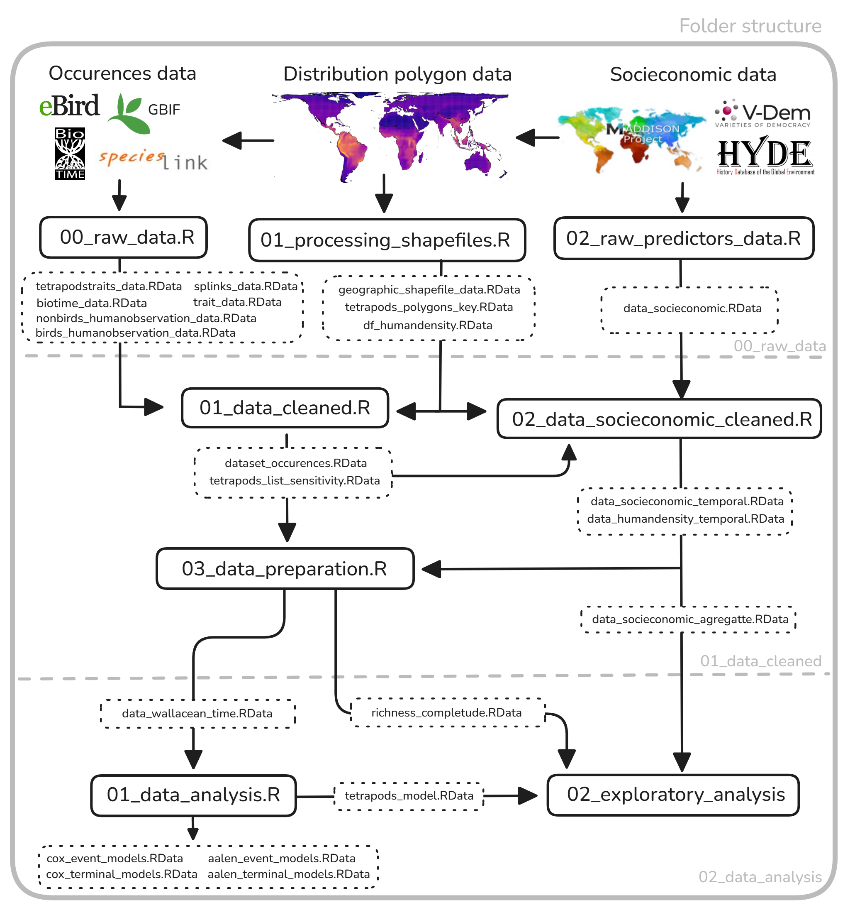

## Description
This repository contains the data and scripts used to investigate the temporal dynamics of geographic biodiversity knowledge and geopolitical inequalities in its accumulation. Using terrestrial vertebrate occurrence records from the Global Biodiversity Information Facility (GBIF), speciesLink, and BioTime, supplemented by geographic range maps and functional trait data from TetrapodTraits, we examine the processes of geodiscovery and geographic range completeness over time, their biological, geographic, and socioeconomic drivers, and disparities in geographic biodiversity knowledge between the Global North and South.

## Contents
- **`\00_raw_data`**: Contains R scripts to obtain the raw data used in the analyses.
- **`\01_data_cleaned`**: Contains R scripts used for data processing, cleaning, and join datasets.
- **`\02_data_analysis`**: Contains R scripts for recurrent-event models, analyses of the predictors influencing geodiscovery and geographic range completeness, and figure generation.

## Data Collection
Occurrence data for terrestrial tetrapods were obtained from the following sources:
1. **Global Biodiversity Information Facility (GBIF)** [www.gbif.org](https://www.gbif.org/)
2. **speciesLink** [https://specieslink.net/](https://specieslink.net/)
3. **BioTime** (Dornelas et al., 2018)

To ensure data quality and taxonomic consistency across different sources, we used the Darwin Core taxonomy framework available via the `rgbif` package API (Chamberlain et al., 2024). Taxonomic matching was validated with a confidence interval greater than 95%.

### Data Cleaning
The data underwent a cleaning process to remove records with imprecise or missing coordinates, following these steps:
1. Removal of records without geographic coordinates.
2. Removal of records that could not be assigned to any geographic range polygon, including those located in disputed areas or at sea.
3. Removal of records without year information.
4. Taxonomic and occurrence-status filtering, retaining only records identified to species or subspecies and with occurrence status other than ABSENT.
5. Application of the `CoordinateCleaner` pipeline (Zizka et al., 2021) to eliminate records with identical latitude and longitude values, coordinates corresponding to GBIF headquarters or biodiversity institutions, marine locations, and zero coordinates.
6. Exclusion of records with spatial uncertainty exceeding 100 km.
7. Cross-database deduplication to remove redundant records arising from the integration of multiple biodiversity data sources.
8. Retention of only occurrence records falling within the respective expert-derived geographic range polygons from TetrapodTraits [https://zenodo.org/records/18926700](Moura et al., 2024).

## Methodology
The data were selected and standardized according to the following criteria:
- **Species selection**: We used TetrapodTraits (Moura et al., 2024) as the reference to select species, ensuring that they met the inclusion criteria: (1) included in global tetrapod phylogenies; (2) described at least 10 years ago; and (3) had functional traits available (e.g., body size, habitat, circadian activity).
- **Taxonomic standardization**: Species were homogenized using the `rgbif` package, specifically Darwin Core taxonomic backbone, to ensure name matching across different taxonomic sources, guaranteeing that occurrences were associated with the same taxonomic entity.

## How to Use the 

## License
This repository is not released for use. 
